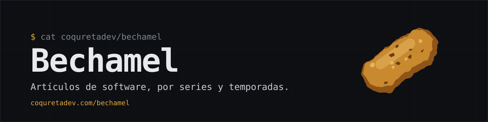

[](https://coquretadev.com/bechamel)

# Bechamel — demos

Código de las demostraciones de [«Bechamel»](https://coquretadev.com/bechamel), la sección de artículos de
Coquretadev. «Bechamel» se organiza en **series** (la primera es Arquitectura) y cada serie en temporadas y episodios.

## Cómo está organizado

Una carpeta por serie y, dentro, una por episodio, con el mismo identificador que el artículo:

```
arquitectura/
└── t0-e01-preguntar-antes-de-construir/
    ├── chapuza/    la versión hecha mal a propósito, la que sale en el artículo
    ├── bien/       la misma, hecha bien
    └── README.md   cómo arrancarla y qué probar para romperla
```

Cada episodio publicado tiene su etiqueta (`arquitectura-t0-e01`…). Los enlaces de los artículos apuntan a la
etiqueta, así que el código que ves es el mismo que había cuando se publicó, aunque el repositorio siga creciendo.

No todos los episodios tienen carpeta: algunos no llevan código.

## ⚠️ Las carpetas `chapuza/` están mal a propósito

El código de `chapuza/` es incorrecto, incompleto o **inseguro a propósito**, para enseñar qué pasa cuando algo se hace
mal. No lo copies en un proyecto real. Cada carpeta `chapuza/` lo repite en su README y en el propio código.

Lo que sí se puede usar como punto de partida está en `bien/`, y aun así es un ejemplo para aprender, no un producto
listo para producción.

## Episodios

Una tabla por serie, con una fila por episodio publicado en el orden de la serie. El ID es el del artículo:
`Arquitectura · T0 · E1` es la serie Arquitectura, temporada 0, episodio 1, y su carpeta es
`arquitectura/t0-e01-<título>/`.

### Arquitectura

Las temporadas siguen el orden en que se construye un sistema: la 0 es pensar antes de construir; la 1, el código.

| ID | Episodio | Artículo | Chapuza | Bien |
| --- | --- | --- | --- | --- |
| — | Todavía no hay ninguno publicado | | | |
